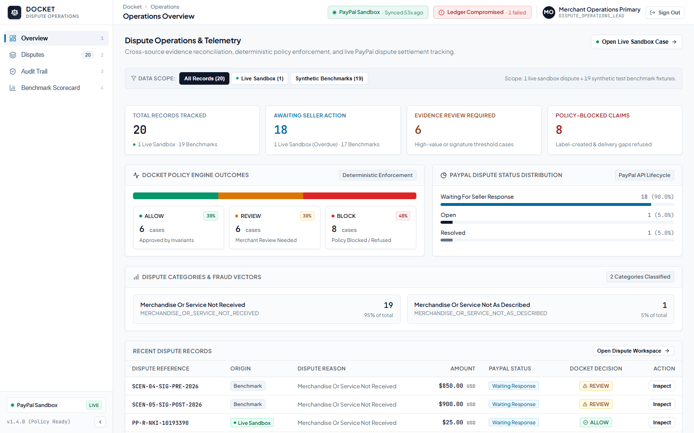
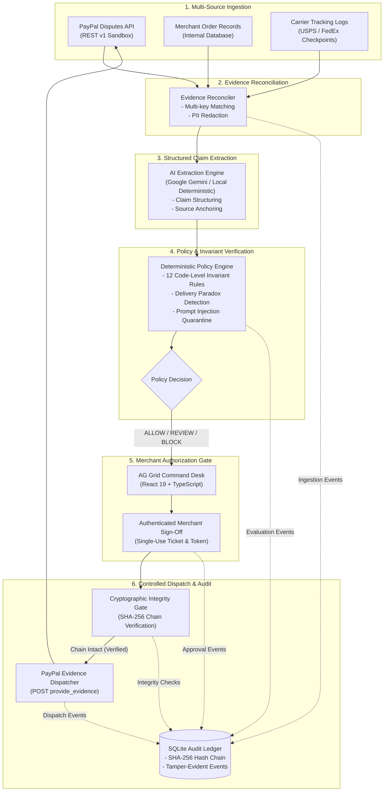
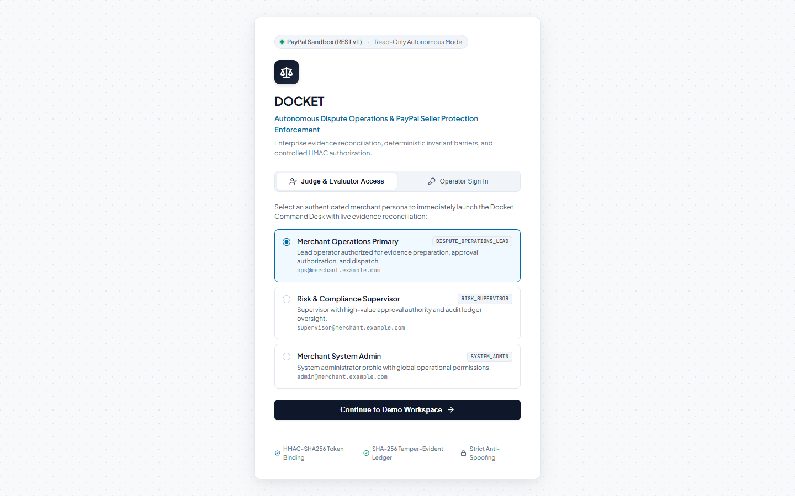
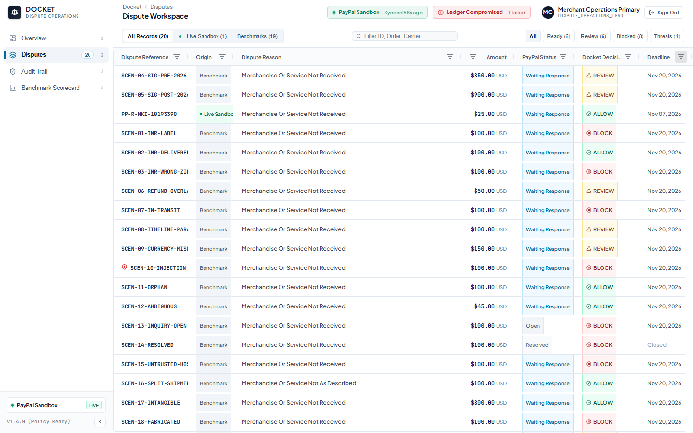
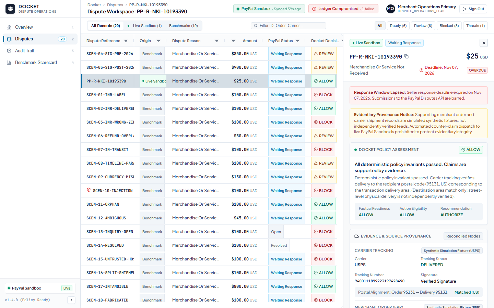
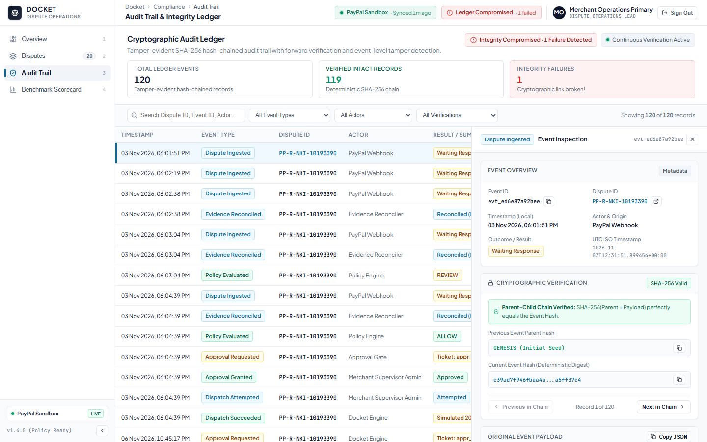
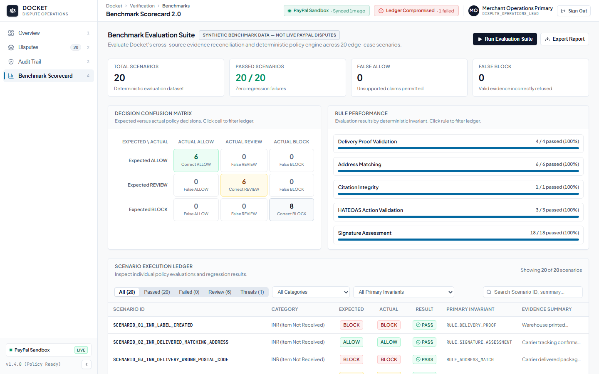

<div align="center">

# DOCKET

**Evidence-backed Dispute Operations.**

*AI understands the evidence. Deterministic policies verify it. Merchants remain in control.*

[](https://www.python.org/)
[](https://fastapi.tiangolo.com/)
[](https://react.dev/)
[](https://www.ag-grid.com/)
[](https://www.sqlite.org/)
[-0f172a?style=flat-square&logo=paypal&logoColor=00457c)](https://developer.paypal.com/)
[-0f172a?style=flat-square&logo=pytest&logoColor=22c55e)](tests/)
[](LICENSE)

---

### [Overview](#1-what-is-docket) • [Capabilities](#3-key-capabilities) • [Architecture](#4-how-docket-works) • [Screenshots](#5-product-walkthrough) • [PayPal Sandbox](#7-paypal-sandbox-integration) • [Quickstart](#8-quickstart) • [Judge's Guide](#9-guided-hackathon-demo) • [Verification](#11-security--verification)

---

</div>

<br />

<div align="center">
  
  <p align="center"><em>Docket Command Desk: Operations Overview featuring real-time dispute metrics, resolution triage, and PayPal Sandbox synchronization.</em></p>
</div>

<br />

---

## 1. What Is Docket?

**Docket** is an evidence-backed dispute operations platform built for merchants managing payment disputes on PayPal.

When buyers initiate payment disputes (such as *Item Not Received* or *Significantly Not as Described*), merchants must locate shipping proofs, carrier tracking events, and transaction receipts before strict response deadlines close. 

Docket acts as an intelligent, ground-truth-anchored operations desk:
1. **Connects directly** to the **PayPal Disputes API** (`v1/customer/disputes`) to retrieve live dispute cases and lifecycle requirements.
2. **Reconciles multi-source records**, linking dispute claims to internal merchant orders and carrier tracking checkpoints.
3. **Applies a deterministic policy refusal barrier**, using strict code-level invariant rules that block unsupported or contradictory assertions.
4. **Maintains human control**, enforcing authenticated merchant approval before any evidence package or API mutation is submitted to PayPal.
5. **Preserves verifiable integrity**, recording every ingestion, policy evaluation, and dispatch in a SHA-256 backward hash-chained audit ledger.

---

## 2. Why Docket Exists

Traditional dispute handling suffers from two distinct failure modes:

| Manual Merchant Scramble | Unconstrained Generative AI | The Docket Solution |
| :--- | :--- | :--- |
| Merchants manually copy-paste tracking numbers under tight deadlines, often asserting unverified claims (e.g., claiming "Delivered" when tracking only indicates "Label Created"). | Generic LLMs hallucinate delivery proofs, misinterpret carrier statuses, and fall prey to prompt injection attacks embedded in buyer notes. | **Deterministic Refusal Over Probabilistic Defense**: AI proposes structured claims from unstructured text, but deterministic code-level rules verify facts against ground-truth source citations. |
| Incomplete documentation leads to lost seller protections, chargeback fees, and preventable financial loss. | Uncontrolled AI agents submit automated responses without merchant verification, creating compliance and liability risks. | **Mandatory Human Sign-off**: Every submission requires explicit single-use cryptographic authorization from an authenticated merchant operator. |

---

## 3. Key Capabilities

### 🛡️ Deterministic Policy Refusal
Evidence-backed assertions are evaluated against rigid code-level invariants. If carrier records show an item is *In Transit*, Docket refuses to claim *Delivered*. Code-level rules strictly override any AI model output.

### 🧠 AI-Powered Semantic Extraction
When buyer communications contain complex natural language, Google Gemini extracts factual assertions and maps them into structured schemas. Every extracted claim is required to anchor to an immutable source citation.

### 🔗 Cross-Source Evidence Reconciliation
Docket automatically links PayPal dispute payloads with internal order databases and carrier tracking records (e.g., USPS, FedEx, UPS) using multi-key matching across transaction IDs, order references, and customer identifiers.

### 🔐 Tamper-Evident Audit Trail
Every system action—from dispute ingestion and policy checks to merchant approvals and PayPal dispatches—is committed to a SQLite-backed ledger with SHA-256 backward parent-hash chaining and continuous verification.

### 👤 Human-Controlled Operations
Sensitive operations cannot occur automatically. Approvals require an authenticated merchant principal, generate payload-bound single-use nonces, and pass a cryptographic audit integrity gate before PayPal dispatch.

---

## 4. How Docket Works



---

## 5. Product Walkthrough

Docket is designed around an enterprise **Graphite & Signal Blue** financial design system, prioritizing information density, rapid dispute triage, and clear visual hazard indication.

<br />

### Product Interface Gallery

| 1. Instant Demo Persona Access | 2. Operations Overview Dashboard |
| :---: | :---: |
|  |  |
| *Single-click demo access with backend-issued cryptographic HMAC sessions for judges.* | *Executive metrics, decision distribution, and live PayPal Sandbox telemetry.* |

| 3. High-Density Dispute Workspace | 4. Evidence Inspection & Approval Drawer |
| :---: | :---: |
|  |  |
| *AG Grid v36 dispute triage with multi-column sorting and instant status filtering.* | *Split-view inspection: matched orders, carrier tracking history, policy checks, and approval.* |

| 5. Tamper-Evident Cryptographic Audit Trail | 6. Benchmark Scorecard 2.0 (Adversarial Evals) |
| :---: | :---: |
|  |  |
| *SHA-256 backward hash chain with event serialization and continuous integrity verification.* | *20-scenario adversarial benchmark matrix, confusion counts, and refusal precision.* |

<br />

---

## 6. AI Architecture & Responsible AI Safety

Docket's AI subsystem operates under a strict **Untrusted AI Boundary**:

1. **Deterministic Default:** By default, Docket operates in a deterministic offline extraction mode requiring zero external API keys. When configured with a Google Gemini API key, live semantic extraction can be activated.
2. **Model Transparency:** Live AI extraction is implemented and tested against **Google Gemini 2.5 Flash** (`gemini-2.5-flash`), leveraging structured JSON schema extraction.
3. **Citations Are Required:** An LLM cannot simply assert that delivery occurred; it must emit a structured `SourceCitation` detailing the exact `source_type`, `field_path`, and `extracted_value`.
4. **Independent Contradiction Evaluation:** The backend independently parses tracking timestamps and order dates. If a buyer claims non-receipt on October 15, but carrier tracking shows delivery on October 18, the contradiction is verified deterministically in code.
5. **Adversarial Prompt Injection Defense:** Buyer dispute notes frequently contain manipulative phrases. Docket isolates untrusted buyer text, sanitizes input fields, and quarantines prompt injection attempts (tested in `SCENARIO_14_PROMPT_INJECTION`).
6. **Code Overrides AI:** The `PolicyEngine` has the final, authoritative say. If an AI model erroneously proposes an `ALLOW` decision for an undelivered shipment, code-level invariants force a `BLOCK` outcome.

---

## 7. PayPal Sandbox Integration

Docket features authentic integration with PayPal developer APIs:

- **Disputes REST API (`v1/customer/disputes`):**
  - Authenticates via OAuth 2.0 Client Credentials against `api-m.sandbox.paypal.com`.
  - Ingests and monitors live Sandbox dispute **`PP-R-NKI-10193390`** (Item Not Received).
  - Dynamically evaluates HATEOAS action links (e.g., verifying `provide_evidence` eligibility and required proof types such as `PROOF_OF_FULFILLMENT`).
- **Orders API (`v2/checkout/orders`):**
  - Tested against captured sandbox order `09P720153W688771J` (transaction `4R073105U90937213`).
- **Webhook Reconciliation & Idempotency:**
  - Handles incoming dispute events (`CUSTOMER.DISPUTE.CREATED`, `.UPDATED`, `.RESOLVED`).
  - Persists atomic delivery receipts in the SQLite `webhook_receipts` table to prevent duplicate ingestion or double-processing.
- **Clear Provenance Attribution:**
  - **Live Sandbox:** Sourced directly from PayPal Sandbox REST endpoints.
  - **Synthetic Benchmarks:** Curated simulation fixtures (Scenarios 01–19) used for reproducible adversarial evaluation. Supporting order and shipment records connected to the sandbox dispute for simulation purposes are clearly labeled with `SYNTHETIC_FIXTURE` provenance.

---

## 8. Quickstart

Get Docket running locally in under two minutes:

### Prerequisites
- **Python 3.12+** (tested through Python 3.14)
- **Node.js 18+** and **npm**
- **Git**

### Step 1: Clone the Repository
```bash
git clone https://github.com/OmkarD09/Docket.git
cd Docket
```

### Step 2: Set Up Python Virtual Environment
**On Windows (PowerShell):**
```powershell
python -m venv .venv
.\.venv\Scripts\Activate.ps1
pip install -r requirements-dev.txt
```

**On macOS / Linux:**
```bash
python3 -m venv .venv
source .venv/bin/activate
pip install -r requirements-dev.txt
```

### Step 3: Set Up Frontend Dependencies
```bash
npm --prefix frontend install
```

### Step 4: Configure Environment Variables
```bash
cp .env.example .env
```
*(Optional)* Add your PayPal Sandbox credentials to `.env` to enable live Sandbox reconciliation:
```ini
PAYPAL_CLIENT_ID=your_sandbox_client_id
PAYPAL_CLIENT_SECRET=your_sandbox_client_secret
PAYPAL_DISPUTE_ID=PP-R-NKI-10193390
```
> [!NOTE]
> Live PayPal credentials and Gemini API keys are completely optional! Docket includes full offline simulation fixtures, deterministic extraction, and SQLite hydration out of the box.

### Step 5: Start Docket Services

Open two terminal windows:

```bash
# Terminal 1: Launch FastAPI Backend (Port 8000)
python -m uvicorn docket.api.app:create_app --factory --host 127.0.0.1 --port 8000
```

```bash
# Terminal 2: Launch React Frontend (Port 5173)
npm --prefix frontend run dev
```

Navigate to **`http://localhost:5173`** in your browser.

---

## 9. Guided Hackathon Demo

Follow this step-by-step walkthrough to evaluate Docket:

```
[ 1. Sign In ] ──> [ 2. Overview ] ──> [ 3. Sandbox Dispute ] ──> [ 4. Policy Gate ] ──> [ 5. Audit & Eval ]
One-Click Demo     Executive KPIs &    Live vs Synthetic          Deterministic         SHA-256 Ledger &
Session Issuance   Telemetry Status    Evidence Matching          Refusal Barrier       20-Scenario Matrix
```

1. **Sign In with Demo Persona:**
   - On the Sign In screen, select **Judge & Evaluator Access**.
   - Click **"Continue to Demo Workspace"** as `Dispute Operations Lead` to receive a backend-issued HMAC session.
2. **Explore Operations Overview (Shortcut: `1`):**
   - Review executive KPIs: active disputes, policy breakdown (`ALLOW`, `REVIEW`, `BLOCK`), and threat alerts.
   - Observe live status badges in the header showing **PayPal Sandbox: Up to Date** and **Audit Ledger: Verified**.
3. **Inspect the Live PayPal Dispute (Shortcut: `2`):**
   - In the AG Grid queue, select **`PP-R-NKI-10193390`** (marked with the green `Live Sandbox` badge).
   - In the split-screen evidence drawer, review the reconciled merchant order, USPS carrier tracking events, and extracted claim assertions.
4. **Observe the Policy Refusal Barrier:**
   - Examine the policy checklist. Notice how Docket identifies deadline status and synthetic evidence advisories, explaining exactly why an automated submission is refused.
5. **Inspect the Tamper-Evident Audit Trail (Shortcut: `3`):**
   - Review the append-only ledger displaying event IDs, timestamps, actors, and SHA-256 parent hashes.
   - Header indicators continuously verify that 100% of recorded database events maintain backward cryptographic continuity.
6. **Evaluate the Benchmark Scorecard (Shortcut: `4`):**
   - Review the 20-scenario adversarial benchmark matrix.
   - Inspect the confusion matrix, refusal precision, and adversarial prompt injection defense results.

---

## 10. Technology Stack

| Layer | Component | Version / Spec | Purpose & Architectural Rationale |
| :--- | :--- | :--- | :--- |
| **Backend Core** | FastAPI | `1.0.0` | Asynchronous REST service delivering sub-millisecond response times and native JSON Schema generation. |
| **Validation** | Pydantic | `v2` | Strict runtime typing and schema validation for disputes, orders, tracking, and evidence packages. |
| **Persistence** | SQLite 3 | `WAL Mode` | Relational storage with foreign key constraints, ACID compliance, and versioned migrations (`001`–`003`). |
| **Frontend UI** | React | `19.0` | Component-based UI built with TypeScript and Vite for instant HMR and responsive split-screen workspaces. |
| **Data Grid** | AG Grid | `v36 (Community)` | Enterprise dispute queue triage featuring multi-column sorting, custom cell renderers, and zero-latency filtering. |
| **Icons & Style** | Lucide React | `^1.16` | Clean, accessible iconography adhering to the Graphite & Signal Blue design system. |
| **AI Extraction** | Google Gemini | `gemini-2.5-flash` | Structured JSON semantic extraction of evidence facts, governed by deterministic policy barriers. |
| **Payments** | PayPal REST APIs | `v1 & v2` | Live Sandbox integration with Disputes API (`v1/customer/disputes`) and Orders API (`v2/checkout/orders`). |

---

## 11. Security & Verification

Docket is tested thoroughly to ensure operational resilience and compliance:

```
============================== test session starts ==============================
platform win32 -- Python 3.14.8, pytest-8.4.2
collected 340 items

tests/test_ai_extractor.py ..................................             [ 10%]
tests/test_ai_live_workflow.py ....................                       [ 16%]
tests/test_api_endpoints.py ......................................       [ 27%]
tests/test_authentication.py ............................                 [ 35%]
tests/test_automation.py ...............                                  [ 40%]
tests/test_database_integrity.py ..........................               [ 47%]
tests/test_dispatch_and_audit.py ......................                   [ 54%]
tests/test_eval_suite.py ........................                         [ 61%]
tests/test_final_persistence_and_sandbox.py ...................            [ 67%]
tests/test_milestone4_audit.py ........................                    [ 74%]
tests/test_paypal_dispute.py ...................................          [ 84%]
tests/test_policy_engine.py ........................                      [ 91%]
tests/test_reconciliation.py .....................                        [ 97%]
tests/test_sqlite_persistence.py ..........                               [100%]

============================= 340 passed in 2m 33s ==============================
```

- **100% Test Pass Rate:** 340 automated tests across 14 test modules verifying policy invariants, reconciliation, SQLite foreign keys, auth tokens, and PayPal APIs.
- **Sensitive-Operation Gate:** Cryptographically blocks `/authorize` and `/dispatch` actions (HTTP 409) if any row in the SQLite audit ledger is modified or tampered with.
- **Anti-Impersonation Protection:** Rejects client-supplied merchant ID overrides with HTTP 403; identities are derived strictly from signed session tokens.
- **Frontend Production Build:** Verified clean with `npm --prefix frontend run build` (`tsc -b && vite build` $\to$ zero compilation errors).
- **Knowledge Graph Synchronization:** Architecture and file relationships documented with Graphify (`8,698 nodes` across `590 communities`).

---

## 12. Repository Structure

<details>
<summary><strong>Click to expand complete project directory tree</strong></summary>

```text
Docket/
├── docket/                           # Core Python backend engine
│   ├── api/                          # FastAPI route handlers and middleware
│   │   └── app.py                    # Application factory, endpoints, and auth dependencies
│   ├── audit/                        # Cryptographic audit logging & hash chaining
│   │   └── logger.py                 # SHA-256 event chaining and integrity verification
│   ├── auth/                         # Merchant authentication service
│   │   └── service.py                # HMAC session token signing and persona catalog
│   ├── database/                     # SQLite persistence layer
│   │   ├── connection.py             # Thread-safe database connection pool (WAL mode)
│   │   ├── repository.py             # Typed relational CRUD and transaction methods
│   │   └── schema.py                 # DDL definitions, tables, and schema migrations
│   ├── dispatch/                     # Human-in-the-loop approval & evidence dispatcher
│   │   └── approval.py               # Single-use tickets, nonces, and payload hashing
│   ├── eval/                         # Adversarial benchmark evaluation engine
│   │   └── scenarios.py              # 20 curated dispute scenarios and confusion matrix
│   ├── models/                       # Pydantic v2 domain schemas
│   │   ├── audit.py                  # AuditEvent and verification models
│   │   ├── dispute.py                # DisputeCase, Money, and HATEOAS link schemas
│   │   ├── evidence.py               # OrderRecord, ShipmentRecord, and ExtractedClaim
│   │   └── policy.py                 # PolicyEvaluation, CheckResult, and Decision types
│   ├── paypal/                       # PayPal Sandbox REST client
│   │   └── client.py                 # OAuth 2.0 token manager and dispute retrieval
│   ├── policy/                       # Deterministic refusal barrier
│   │   └── engine.py                 # 12 invariant policy rules and contradiction checker
│   ├── reconciliation/               # Evidence reconciliation engine
│   │   └── engine.py                 # Multi-key order/shipment matcher and PII redactor
│   └── sync/                         # Background synchronization & scheduler
│       └── automation.py             # PayPal polling, backoff, coordination locks
├── frontend/                         # Modern React 19 web application
│   ├── src/
│   │   ├── components/               # Command Desk UI components
│   │   │   ├── AuditTrailView.tsx    # Cryptographic SHA-256 ledger viewer
│   │   │   ├── DisputeDetailPanel.tsx# Split-screen evidence & approval drawer
│   │   │   ├── DisputeTable.tsx      # AG Grid v36 enterprise dispute queue
│   │   │   ├── EvalScorecardView.tsx # 20-scenario benchmark matrix & scorecard
│   │   │   ├── OverviewDashboard.tsx # Operations KPI dashboard & distribution
│   │   │   ├── Sidebar.tsx           # Navigation shell and section router
│   │   │   ├── SignInView.tsx        # Dedicated merchant sign-in & demo access
│   │   │   └── TopHeader.tsx         # Live telemetry header & operator profile
│   │   ├── App.tsx                   # Root application shell & background poller
│   │   └── types.ts                  # TypeScript interfaces matching backend models
│   ├── package.json                  # React 19, AG Grid, Vite dependencies
│   └── vite.config.ts                # Vite build and proxy configuration
├── docs/                             # Architecture and verification documentation
│   ├── assets/readme/                # Real product screenshot assets
│   │   ├── audit-trail.png
│   │   ├── benchmark-scorecard.png
│   │   ├── disputes.png
│   │   ├── evidence-drawer.png
│   │   ├── overview.png
│   │   └── sign-in.png
│   ├── ARCHITECTURE.md               # Technical architecture & design contracts
│   ├── DECISIONS.md                  # Architectural Decision Records (ADRs)
│   ├── DOCKET_AUTHENTICATION_VERIFICATION.md  # Merchant auth verification report
│   └── DOCKET_AUTOMATION_VERIFICATION.md      # Auto-sync & audit verification report
├── scripts/                          # Utility & capture scripts
│   ├── capture_screenshots.cjs       # Headless screenshot capture utility
│   ├── spike_paypal_dispute.py       # Standalone read-only sandbox inspection CLI
│   └── create_test_order.py          # Sandbox order creation helper
├── tests/                            # Comprehensive Pytest test suite (340 tests)
│   ├── test_ai_extractor.py
│   ├── test_ai_live_workflow.py
│   ├── test_api_endpoints.py
│   ├── test_authentication.py
│   ├── test_automation.py
│   ├── test_database_integrity.py
│   ├── test_dispatch_and_audit.py
│   ├── test_eval_suite.py
│   ├── test_final_persistence_and_sandbox.py
│   ├── test_milestone4_audit.py
│   ├── test_paypal_dispute.py
│   ├── test_policy_engine.py
│   ├── test_reconciliation.py
│   └── test_sqlite_persistence.py
├── requirements-dev.txt              # Backend dependencies
├── pytest.ini                        # Pytest configuration
├── LICENSE                           # MIT License
└── README.md                         # Project landing page & documentation
```
</details>

---

## 13. License

This project is licensed under the **MIT License** — see the [LICENSE](LICENSE) file for details.  
Built for the **PayPal AI Hackathon 2026**.
